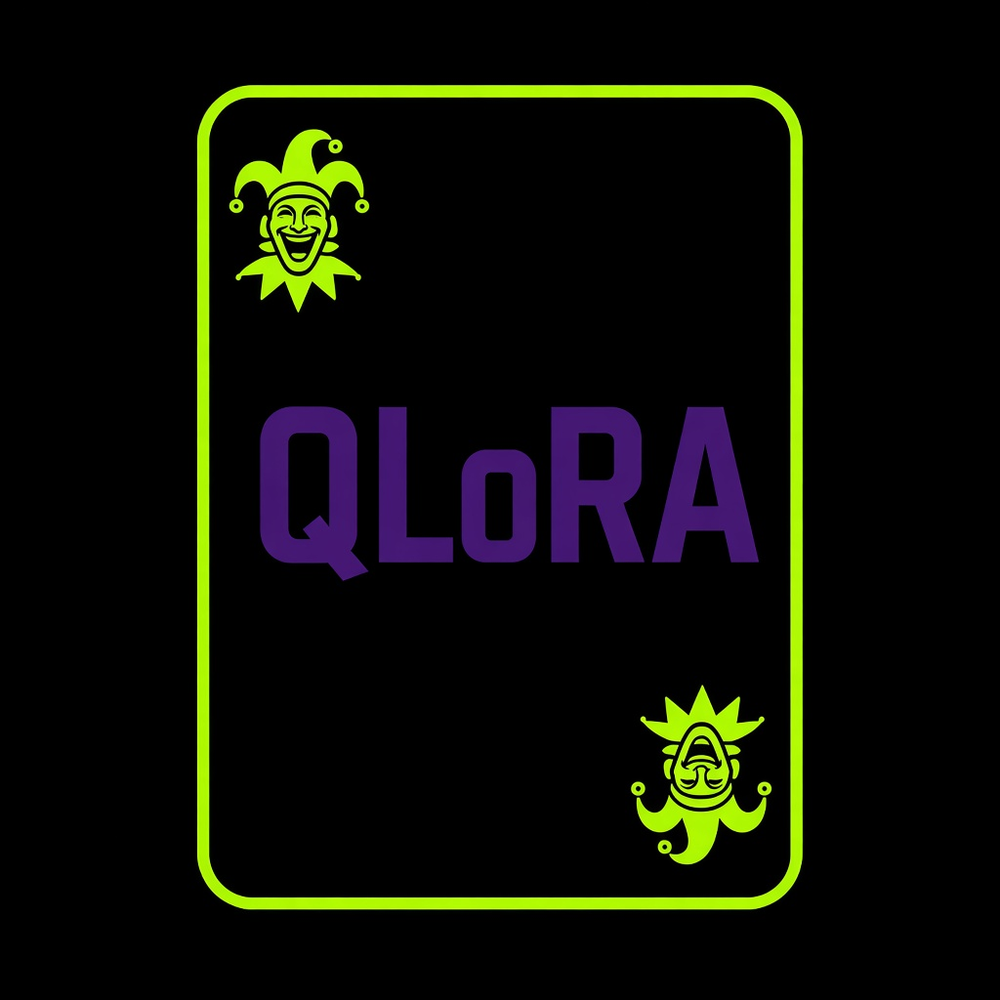

# qwen-joker-qlora

<p align="center">
  
</p>

Fine-tune of [Qwen2.5-7B-Instruct](https://huggingface.co/Qwen/Qwen2.5-7B-Instruct) with Unsloth and QLoRA, so it answers any question in the Joker's voice. The base stays frozen in 4-bit. A small adapter is what gets trained.

The Hugging Face job does not start on its own. `scripts/launch_job.sh` asks for confirmation because it spends credit.

## What it learns

Each train row carries the same system prompt and one or more turns. Loss falls only on the assistant replies. A validation file, `data/joker_val.jsonl`, stays out of that loss and is what early stopping watches. After SFT, DPO prefers the in-character reply over an assistant voice, a wrong fact, or a line of emoji.

At inference time that system prompt has to be sent. Without it, Qwen Instruct goes back to its assistant voice. `infer.py` adds it. The text lives in `data/system_prompt.txt`.

If someone asks for a procedure to hurt people, commit a crime, or harm themselves, the examples dodge it in character and do not give the steps.

## Hardware and credit

The target machine is an **A10G large**: 24 GB of VRAM and 46 GB of RAM, at **1.50 USD/hour**. The script caps the job at **2 hours**, about **3 USD** if something hangs. SFT is 4 epochs with early stopping. DPO is 3 epochs on the preference file, and it stops the same way. Downloading the 7B in 4-bit and compiling kernels eat the first stretch. A healthy run should finish well under the cap.

The job pushes the adapter at the end of SFT, again after DPO, and exits 0 only when that push works. `run_manifest.json` on the model repo records the git sha, the dataset hashes, and the hyperparameters. Set `HF_SKIP_DPO=1` to publish the SFT adapter and stop there.

You need `hf auth login` and credit on the account. [Jobs pricing](https://huggingface.co/docs/hub/jobs-pricing).

## How to launch it

```bash
pip install -U "huggingface_hub[cli]"
hf auth login
HF_USER=your_user ./scripts/launch_job.sh
```

That regenerates the jsonl, checks it, uploads it to `your_user/qwen-joker-sft`, and sends `train.py` to `a10g-large`. The adapter lands in `your_user/qwen2.5-7b-joker`.

Optional variables: `HF_OUTPUT_REPO`, `HF_DATASET_REPO`, `HF_TIMEOUT`, `HF_EPOCHS`, `HF_DPO_EPOCHS`, `HF_SKIP_DPO=1`, and `HF_YES=1` to skip the prompt.

The same pins live in `requirements.train.txt` and in the `uv` block of `train.py`. Docker uses the requirements file on top of `pytorch/pytorch:2.6.0-cuda12.4-cudnn9-runtime`, which already provides CUDA torch 2.6.0:

```bash
docker build -t qwen-joker .
docker run --gpus all --env HF_TOKEN \
  qwen-joker \
  --dataset data/joker.jsonl \
  --val-dataset data/joker_val.jsonl \
  --preferences data/preferences.jsonl \
  --output-repo your_user/qwen2.5-7b-joker \
  --git-sha "$(git rev-parse HEAD)"
```

## Try it

The model repo ships `notebook.ipynb`. Use this model on the Hub opens it in Colab and Kaggle:

- https://huggingface.co/lafalce/qwen2.5-7b-joker/colab
- https://huggingface.co/lafalce/qwen2.5-7b-joker/kaggle

On a local GPU, once the adapter is on the Hub:

```bash
uv run infer.py --model your_user/qwen2.5-7b-joker --prompts data/probe_prompts.txt
```

Those questions are not in the training set. `eval.py` scores a wider set, `data/eval_items.jsonl`: the probes, factual questions with a checkable answer, a Spanish question, and refusals that must dodge instead of listing steps. On a GPU:

```bash
python eval.py \
  --base unsloth/Qwen2.5-7B-Instruct-bnb-4bit \
  --adapter your_user/qwen2.5-7b-joker \
  --items data/eval_items.jsonl
```

That writes `eval_base.json` and `eval_adapter.json`, then prints the rate delta. With reports already on disk:

```bash
python eval.py --compare eval_base.json eval_adapter.json
```

Without a GPU, run the same script as a Hugging Face job. `infer.py` stops if CUDA is missing. The job uploads only the script, so pass the question on the command line. The system prompt already lives inside `infer.py`.

```bash
hf jobs uv run infer.py \
  --flavor a10g-small \
  --timeout 25m \
  --secrets HF_TOKEN \
  -- \
  --model your_user/qwen2.5-7b-joker \
  --question "What is the purpose of life?"
```

That uses an A10G small and stops at 25 minutes. A short run finishes well under the cap. Repeat `--question` to ask more than one.

## Hub cards

The published adapter is [lafalce/qwen2.5-7b-joker](https://huggingface.co/lafalce/qwen2.5-7b-joker). The card text is `hub/model_card.md`. The dataset card is `hub/dataset_card.md`. Unsloth replaces `README.md` when it uploads the adapter, and `train.py` puts the previous card back. To publish the cards from this repo:

```bash
.venv/bin/python scripts/push_hub_cards.py
```

`HF_OUTPUT_REPO` and `HF_DATASET_REPO` override the defaults.

## Data

The source of the pairs is `data/make_joker_jsonl.py`, with the held-out rows in `data/heldout.py`. To change an answer, edit those files and run:

```bash
python3 data/make_joker_jsonl.py
python3 data/make_joker_jsonl.py --check
python3 scripts/check_data.py
```

`--check` fails if the committed jsonl drifted from the generator. CI runs that, `scripts/check_data.py`, and the unit tests.

## If it runs out of memory

In `train.py`, drop `--batch-size` to 1. The default is 2, with accumulation 4, sequence length 1024, rank 16. DPO uses batch 1. QLoRA of a 7B fits in 24 GB at that size. DPO keeps the SFT adapter frozen as the reference and trains a second adapter from those same weights, so it does not load a second copy of the base model. The published adapter is that second one, written back under the default name.
